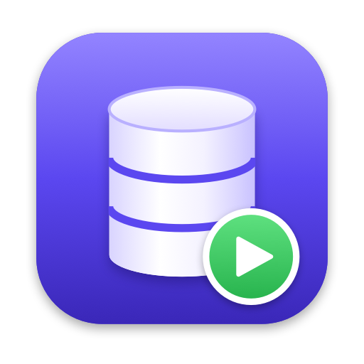

# Miniamp

A local PHP stack for macOS that installs **without admin rights**: PHP, MariaDB and phpMyAdmin from Homebrew,
started at login, managed from a native control panel (or the `miniamp` command line tool). If you know MAMP, it
works much the same way.

| What | Where |
|---|---|
| Your sites | http://localhost:8888 (files in `~/Sites/localhost`) |
| phpMyAdmin | http://localhost:8888/phpMyAdmin/ (logs in automatically) |
| Database | MariaDB on `127.0.0.1:3306`, user `root` / password `root` |

Everything listens on `127.0.0.1` only, so the `root`/`root` defaults are not reachable from the network.

## Requirements

- Apple Silicon Mac, macOS 14 or later
- [Homebrew](https://brew.sh) in `/opt/homebrew`, owned by your user. Installing Homebrew needs an admin once;
  after that, `brew install` works without one.

## Install

1. Download `Miniamp-<version>.zip` from the [latest release](https://github.com/dnovitski/miniamp/releases/latest).
2. Unzip it and move **Miniamp.app** to Applications (or `~/Applications`).
3. Open it. The app is not notarized, so macOS blocks it the first time: open System Settings → Privacy & Security
   and click **Open Anyway** next to "Miniamp".
4. On the **Setup** tab, click **Install** and follow the log.

## Control panel

**Servers** shows the web server and MariaDB with their status, starts and stops them (individually or all at once),
toggles *Start at login*, and opens the website, phpMyAdmin, the document root and the logs.

**Setup** shows a checklist of what is installed and configured:

| Button | What it does |
|---|---|
| Install / Repair | Runs every step that is not done yet: Homebrew packages, MariaDB on 127.0.0.1 with root/root, phpMyAdmin auto-login, web server, `miniamp` command. Then it turns on *Start at login* and starts both servers. Safe to repeat. |
| Update Packages | `brew upgrade php mariadb phpmyadmin`, restarts what was running, then repairs the setup if needed |
| Uninstall… | Stops the servers and removes the Miniamp configuration, optionally also the Homebrew packages. Sites and databases are always kept. |

Progress streams into the log while it runs. Earlier runs are in `~/Library/Logs/miniamp/setup.log`.

The app also lives in the menu bar. Quitting the app does not stop the servers. To show the menu bar icon after
login, add the app under System Settings → General → Login Items.

## Command line

Install links `miniamp` into `/opt/homebrew/bin`. It is the same program as the app:

```
miniamp status                       Show the servers and the setup state
miniamp start|stop|restart [web|db]  Control both servers, or one
miniamp autostart on|off             Start the servers at login
miniamp install                      Install or repair the setup
miniamp update                       Upgrade PHP, MariaDB and phpMyAdmin
miniamp uninstall [--packages]       Remove the setup (sites and databases are kept)
miniamp open                         Open the control panel
```

## How it works

Both servers are launchd LaunchAgents in your own login session, so no root is involved:

| Server | Label | Runs |
|---|---|---|
| Web server | `local.miniamp.web` | `php -S 127.0.0.1:8888` with a small router for `/phpMyAdmin` |
| MariaDB | `sh.brew.mariadb` | Homebrew's own plist, so it stays in sync with `brew services` |

- **Start:** `launchctl bootstrap`, then `kickstart`.
- **Stop:** `launchctl bootout`, then wait until the job is gone. MariaDB needs a few seconds to shut down, and
  restarting before that fails.
- **Start at login:** the plist is present in `~/Library/LaunchAgents`.

| File | Purpose |
|---|---|
| `Sources/Core.swift` | Paths, launchd control, running processes with live output |
| `Sources/Setup.swift` | Install, update and uninstall steps, and the generated config files |
| `Sources/CLI.swift` | The `miniamp` command |
| `Sources/App.swift`, `Sources/Views.swift` | The SwiftUI control panel and menu bar |
| `Sources/main.swift` | Starts the CLI when called with a command, else the app |
| `tools/icon.swift` | Renders the app icon and `logo.png` |
| `build.sh` | Builds `build/Miniamp.app` (`--install` copies it to `~/Applications`) |

## Building and releasing

Building needs Xcode or the Command Line Tools:

```bash
./build.sh --install
```

GitHub Actions builds every push on a macOS runner. Pushing a tag `v1.2.3` publishes a release with
`Miniamp-1.2.3.zip`.

## Trademarks

MAMP is a trademark of appsolute GmbH. Miniamp is an independent project and is not affiliated with or endorsed by
appsolute. Mac and macOS are trademarks of Apple Inc.
